# AfyaLink: Low-Bandwidth Community Health Navigation & Follow-Up Tool


[](LICENSE)
[]()
[]()

---

## 1. Problem and Target User

### The Problem
In many community and rural health environments (such as peri-urban settlements and rural dispensaries across Kenya and East Africa), post-visit follow-up is severely fragmented. Community Health Workers (CHWs) and clinic intake volunteers juggle paper notebooks, loose cards, verbal reminders, and unreliable connectivity. When follow-up instructions are lost or forgotten, patients miss critical re-checks, child immunization milestones, or maternal wellness reviews.

### The Target Users
- **Primary User:** Community Health Workers (CHWs) and rural clinic front-desk workers who need a rapid, lightweight digital register to schedule and track client check-ins without heavy administrative overhead.
- **Secondary User:** Community members who need to remember when their next appointment is and understand what practical step to take next without navigating complex portals or downloading heavy native apps.

---

## 2. What the Prototype Does

AfyaLink solves the follow-up gap through a calm, focused, and resilient tool:
1. **Actionable Dashboard:** Instant summary metrics showing follow-ups due today, upcoming visits, items needing rescheduling, and total active caseload—all calculated live from persisted records.
2. **Digital Follow-Up Register:** A searchable, filterable log of follow-ups displaying pseudonymised names, scheduled dates, broad non-diagnostic categories, and statuses.
3. **Instant Follow-Up Creation:** A guided form with client-side validation to register follow-up check-ins with synthetic identifiers and privacy guardrails.
4. **Live Status Lifecycle:** Toggle statuses seamlessly between **Scheduled**, **Contacted**, **Attended**, and **Needs Rescheduling** with instant persistence across browser reloads.
5. **Scoped "My Next Step" Member View:** A private, focused screen where a community member enters their demo code (e.g., `DEMO-A1`) to view *only* their own appointment date and next step card—without exposing the clinic's full register.
6. **Data Portability:** One-click CSV export of synthetic records for offline reporting.
7. **Offline-Resilient Architecture:** Operates immediately in low-connectivity settings via localStorage, backed by a repository abstraction ready for cloud sync.

---

## 3. Screens and Demo Workflow

| Screen | Purpose | Key Actions |
|---|---|---|
| **Overview (Dashboard)** | High-level situation awareness for the CHW | View counts (Due Today, Upcoming, Needs Rescheduling), see today's list, quick status change |
| **Follow-up Register** | Full roster management | Search by name/code, filter by status, export CSV, launch "Add Follow-Up" modal |
| **Add Follow-Up Modal** | Capture a new check-in | Input pseudonym, pick date, select non-diagnostic category, add brief operational note |
| **My Next Step (Member View)**| Scoped, patient-facing reminder card | Look up via demo code (e.g., `DEMO-A1`, `DEMO-B2`), view appointment date & instructions |
| **About & Safety** | Transparent safety & operational boundaries | Urgent help notice, clinical disclaimers, data privacy details, open-source licence |

### Recommended 60-Second Demo Script:
1. Open **Overview** → Observe the live counts calculated dynamically relative to today's date.
2. Navigate to **Follow-ups** → Click **Add Follow-Up** → Enter `"Demo Participant 7"`, select tomorrow's date, choose `"Maternal health follow-up"`, save.
3. Notice the new record appears immediately in the register.
4. Change status from `Scheduled` to `Contacted` using the dropdown.
5. Refresh the browser page (`F5` / `Ctrl+R`) → Verify data persists.
6. Navigate to **Member View** → Enter demo code `DEMO-A1` → View the scoped patient next-step card.

---

## 4. Architecture and Data Flow

```mermaid
%% Generated by https://gitdiagram.com/agustasvj/afyalink
flowchart TD

subgraph group_experience["User experience"]
  node_app["App routing<br/>[App.tsx]"]
  node_shell["Navigation shell<br/>[AppShell.tsx]"]
  node_dashboard["Dashboard metrics<br/>[DashboardPage.tsx]"]
  node_register["Follow-up register<br/>[FollowUpsPage.tsx]"]
  node_memberview["Member next step<br/>[MemberViewPage.tsx]"]
  node_form["Creation form<br/>[FollowUpForm.tsx]"]
  node_list["Follow-up list<br/>[FollowUpList.tsx]"]
  node_summary["Summary cards<br/>[SummaryCard.tsx]"]
  node_badge["Status badge<br/>[StatusBadge.tsx]"]
end

subgraph group_domain["Follow-up domain"]
  node_validation["Input validation<br/>[validation.ts]"]
  node_types["Follow-up model<br/>[types.ts]"]
  node_repository["Repository contract"]
end

subgraph group_persistence["Persistence"]
  node_local["Local storage adapter"]
  node_browserstore[("Browser localStorage")]
  node_demodata["Demo record seeder<br/>[demoFollowUps.ts]"]
  node_supabase[("Supabase cloud store<br/>[schema.sql]")]
end

subgraph group_support["Safety and portability"]
  node_csv["CSV export<br/>[FollowUpsPage.tsx]"]
  node_safety["Safety information"]
  node_safetynotice["Safety notice<br/>[SafetyNotice.tsx]"]
end

node_worker(("Health worker"))
node_member(("Community member"))

node_worker -->|"uses"| node_app
node_member -->|"uses"| node_app
node_app -->|"renders"| node_shell
node_app -->|"routes to"| node_dashboard
node_app -->|"routes to"| node_register
node_app -->|"routes to"| node_memberview
node_app -->|"routes to"| node_safety
node_app -->|"seeds via"| node_local
node_dashboard -->|"lists and updates"| node_repository
node_dashboard -->|"renders"| node_summary
node_dashboard -->|"renders"| node_badge
node_dashboard -->|"navigates to"| node_register
node_register -->|"lists, creates, updates"| node_repository
node_register -->|"renders"| node_list
node_register -->|"renders"| node_form
node_register -->|"generates"| node_csv
node_form -->|"validates with"| node_validation
node_form -->|"uses input types"| node_types
node_memberview -->|"looks up code"| node_repository
node_memberview -->|"renders"| node_badge
node_list -->|"renders"| node_badge
node_list -->|"uses statuses"| node_types
node_repository -->|"defines contract types"| node_types
node_local -->|"implements"| node_repository
node_local -->|"reads and writes"| node_types
node_local -->|"reads and writes"| node_browserstore
node_local -->|"seeds from"| node_demodata
node_safety -->|"renders"| node_safetynotice
node_local -.->|"cloud alternative documented"| node_supabase

click node_app "https://github.com/agustasvj/afyalink/blob/main/src/app/App.tsx"
click node_shell "https://github.com/agustasvj/afyalink/blob/main/src/components/AppShell.tsx"
click node_dashboard "https://github.com/agustasvj/afyalink/blob/main/src/pages/DashboardPage.tsx"
click node_register "https://github.com/agustasvj/afyalink/blob/main/src/pages/FollowUpsPage.tsx"
click node_memberview "https://github.com/agustasvj/afyalink/blob/main/src/pages/MemberViewPage.tsx"
click node_form "https://github.com/agustasvj/afyalink/blob/main/src/components/FollowUpForm.tsx"
click node_list "https://github.com/agustasvj/afyalink/blob/main/src/components/FollowUpList.tsx"
click node_summary "https://github.com/agustasvj/afyalink/blob/main/src/components/SummaryCard.tsx"
click node_badge "https://github.com/agustasvj/afyalink/blob/main/src/components/StatusBadge.tsx"
click node_validation "https://github.com/agustasvj/afyalink/blob/main/src/features/follow-ups/validation.ts"
click node_types "https://github.com/agustasvj/afyalink/blob/main/src/features/follow-ups/types.ts"
click node_repository "https://github.com/agustasvj/afyalink/blob/main/src/features/follow-ups/followUpRepository.ts"
click node_local "https://github.com/agustasvj/afyalink/blob/main/src/features/follow-ups/localStorageRepository.ts"
click node_demodata "https://github.com/agustasvj/afyalink/blob/main/src/data/demoFollowUps.ts"
click node_csv "https://github.com/agustasvj/afyalink/blob/main/src/pages/FollowUpsPage.tsx"
click node_safety "https://github.com/agustasvj/afyalink/blob/main/src/pages/AboutSafetyPage.tsx"
click node_safetynotice "https://github.com/agustasvj/afyalink/blob/main/src/components/SafetyNotice.tsx"
click node_supabase "https://github.com/agustasvj/afyalink/blob/main/supabase/schema.sql"

classDef toneNeutral fill:#f8fafc,stroke:#334155,stroke-width:1.5px,color:#0f172a
classDef toneBlue fill:#dbeafe,stroke:#2563eb,stroke-width:1.5px,color:#172554
classDef toneAmber fill:#fef3c7,stroke:#d97706,stroke-width:1.5px,color:#78350f
classDef toneMint fill:#dcfce7,stroke:#16a34a,stroke-width:1.5px,color:#14532d
classDef toneRose fill:#ffe4e6,stroke:#e11d48,stroke-width:1.5px,color:#881337
classDef toneIndigo fill:#e0e7ff,stroke:#4f46e5,stroke-width:1.5px,color:#312e81
classDef toneTeal fill:#ccfbf1,stroke:#0f766e,stroke-width:1.5px,color:#134e4a
class node_app,node_shell,node_dashboard,node_register,node_memberview,node_form,node_list,node_summary,node_badge toneBlue
class node_validation,node_types,node_repository toneAmber
class node_local,node_browserstore,node_demodata,node_supabase toneMint
class node_csv,node_safety,node_safetynotice,node_worker toneRose
class node_member toneIndigo
```



```text
┌──────────────────────────────────────────────────────────┐
│              React 18 UI Layer (TypeScript)              │
│  (AppShell / DashboardPage / FollowUpsPage / MemberView) │
└────────────────────────────┬─────────────────────────────┘
                             │
                             ▼
┌──────────────────────────────────────────────────────────┐
│          Validation & Domain Logic (Pure TS)             │
│        (validateFollowUpInput / types / categories)      │
└────────────────────────────┬─────────────────────────────┘
                             │
                             ▼
┌──────────────────────────────────────────────────────────┐
│            FollowUpRepository Interface                  │
│   listFollowUps() | createFollowUp() | updateStatus()    │
└──────────────┬────────────────────────────┬──────────────┘
               │ (active default)           │ (stretch goal)
               ▼                            ▼
┌──────────────────────────────┐   ┌───────────────────────┐
│    LocalStorageRepository    │   │  SupabaseRepository   │
│   (Browser Storage / Zero    │   │  (Postgres with RLS   │
│    Network Requirements)     │   │   & Auth Guardrails)  │
└──────────────────────────────┘   └───────────────────────┘
```

The data abstraction layer completely decouples presentation from storage. The UI components interact exclusively with the `FollowUpRepository` interface. If cloud connectivity is unavailable or unconfigured, the application runs uninterrupted with client-side persistence.

---

## 5. Technology Stack & Design Decisions

- **Frontend Core:** React 18 with TypeScript for type-safe contracts and robust status transitions.
- **Build Tool:** Vite 6 for ultra-fast development, instant Hot Module Replacement (HMR), and lean production bundles (<60 kB gzipped JS).
- **Styling:** Custom Vanilla CSS Design System with CSS custom properties (tokens), modern typography (`Inter`), and responsive media queries. Zero runtime CSS overhead, maximum performance on low-spec mobile devices.
- **Icons:** Lucide React for consistent, lightweight, and accessible iconography.
- **Persistence:** Browser `localStorage` with JSON serialization and defensive fallback error handling.
- **Design Philosophy:** "Warm clinical, human-centred" visual language:
  - Background: Soft warm grey/off-white (`#F7F8F6`)
  - Primary: Deep healthcare teal (`#116A62`)
  - Text: Dark charcoal teal (`#172B2A`)
  - Accent: Restrained mint (`#DDF3E8`)
  - Status Indicators: Amber (`#A96312`), Danger (`#B42318`), Teal (`#116A62`)

---

## 6. Data Model & Privacy Approach

### Schema (`FollowUp` interface)
```typescript
interface FollowUp {
  id: string;            // Unique UUID / random ID
  displayName: string;   // Pseudonym or demo name (Max 80 chars)
  followUpDate: string;  // ISO date YYYY-MM-DD
  category: Category;    // Fixed broad non-diagnostic categories
  status: Status;        // 'scheduled' | 'contacted' | 'attended' | 'needs_rescheduling'
  note: string;          // Non-sensitive operational note (Max 300 chars)
  demoCode: string;      // Non-identifying token for member view (e.g. DEMO-A1)
  createdAt: string;     // ISO timestamp
  updatedAt: string;     // ISO timestamp
}
```

### Privacy & Ethical Boundaries:
- **Zero Real Data:** All seeded records use fictional demo names (`Demo Member A`, etc.) and relative dates.
- **No Sensitive Identifiers:** Never collects national ID numbers, exact physical addresses, phone numbers, or clinical history.
- **No Diagnostics or Triage:** Does not diagnose symptoms, prescribe treatments, or suggest clinical dosages.
- **Zero Third-Party Leaks:** In the default offline configuration, no data ever leaves the user's browser.

---

## 7. Setup Instructions (Clean Clone)

### Prerequisites
- Node.js (v18.0.0 or higher recommended)
- npm (v9.0.0 or higher)

### Installation & Run

```bash
# 1. Clone the repository
git clone https://github.com/YOUR_TEAM/afyalink.git
cd afyalink

# 2. Install dependencies
npm install

# 3. Start local development server
npm run dev
```

Open your browser at `http://localhost:5173`.

### Production Build & Preview
```bash
# Compile TypeScript and bundle with Vite
npm run build

# Preview the production bundle locally
npm run preview
```

---

## 8. Environment Variables

AfyaLink runs completely out of the box with zero environment variables needed!

If configuring the optional Supabase cloud storage stretch goal, copy `.env.example` to `.env`:
```bash
cp .env.example .env
```
Populate the placeholder variables:
```env
VITE_SUPABASE_URL=https://your-project-id.supabase.co
VITE_SUPABASE_ANON_KEY=your-anon-public-key
```

---

## 9. Deployment Instructions (Vercel / Netlify)

### Deploy to Vercel
1. Push your repository to GitHub.
2. In the [Vercel Dashboard](https://vercel.com), click **Add New Project** and import `afyalink`.
3. Configure settings:
   - **Framework Preset:** Vite
   - **Build Command:** `npm run build`
   - **Output Directory:** `dist`
4. Click **Deploy**.

### Deploy to Netlify
1. Connect repository in [Netlify Dashboard](https://netlify.com).
2. Set build command to `npm run build` and publish directory to `dist`.
3. Click **Deploy Site**.

---

## 10. Clinical & Safety Note

> **CRITICAL NOTICE:** AfyaLink is a buildathon concept prototype and is **not an emergency response service or diagnostic medical device**.
> 
> If a community member experiences a medical emergency, acute distress, or life-threatening symptoms, they must seek immediate emergency medical care or visit the nearest qualified medical facility. AfyaLink does not replace clinical judgement, qualified medical professionals, or official healthcare delivery protocols.

---

## 11. AI-Assisted Coding Disclosure

In adherence to the IEEE Day 2026 Buildathon rules, the team discloses the following AI assistance:
- **Tool Used:** Antigravity AI Coding Assistant (Gemini / Claude models)
- **Scope of Use:**
  - Architecture and component scaffolding based on the prompt specification.
  - TypeScript interface definitions, validation routines, and CSS design system styling.
  - Reviewing code against buildathon acceptance criteria and drafting documentation.
  - All generated code was inspected, verified, built, and tested by the team.

---

## 12. Team Members & Contributions

- **Team Member 1:** [Full Name / Role — e.g., Technical Lead & Architecture]
- **Team Member 2:** [Full Name / Role — e.g., UI/UX & Frontend Development]
- **Team Member 3:** [Full Name / Role — e.g., Data Modeling, Testing & Quality Assurance]
- **Team Member 4:** [Full Name / Role — e.g., Pitch Delivery & Product Documentation]

---

## 13. Limitations & Roadmap

### Current Limitations:
- LocalStorage persistence is confined to a single browser profile and does not synchronize across multiple CHW devices.
- SMS and WhatsApp dispatch are simulated in-app; no third-party SMS gateway credentials are connected.
- Scoped member view uses simple demo codes rather than cryptographic one-time links.

### Future Roadmap:
- Multi-CHW synchronization using Supabase Postgres with granular Row Level Security (RLS) policies.
- Low-cost Africa's Talking / Twilio SMS gateway integration for offline SMS notification delivery.
- Progressive Web App (PWA) service worker caching for complete offline operability with background sync.
- Swahili and local language localization toggles.

---

## 14. Licence

This project is open-source under the [MIT Licence](LICENSE).
Part of the IEEE Day 2026 Buildathon — Track 1: Health and Humanity (IEEE Moi University Student Branch).
